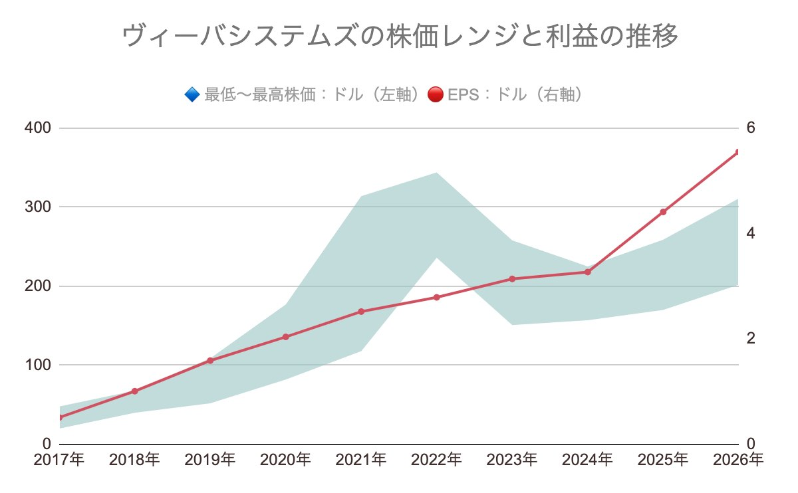
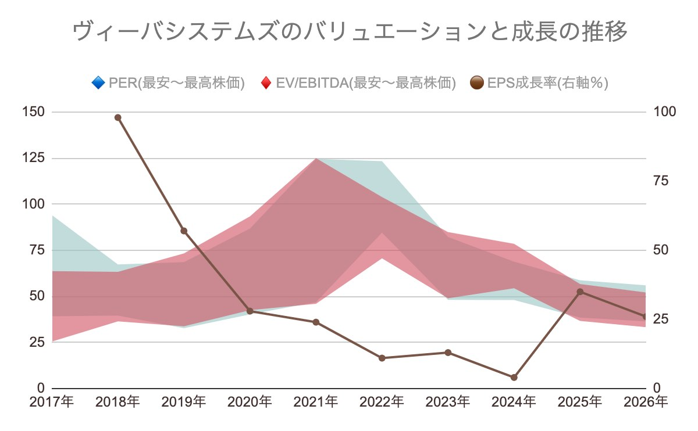
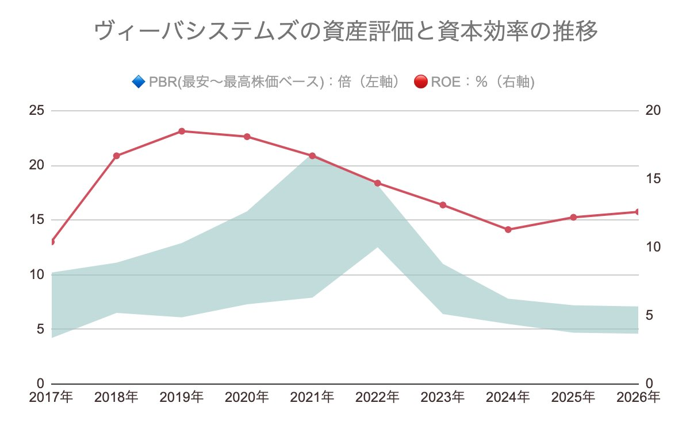
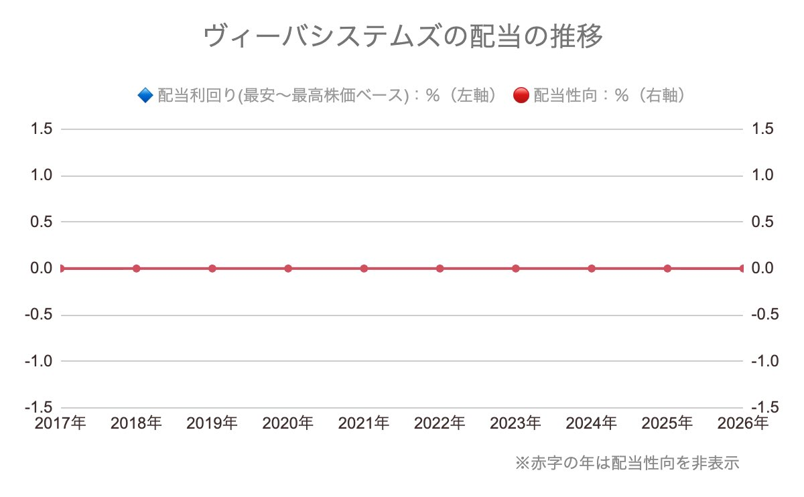

❽本文を書く

もくじ
* TOC
{:toc}

## 株価の評価指標🔍まとめ
<iframe src="https://docs.google.com/spreadsheets/d/e/2PACX-1vR1yisiDY6gQ6B0Zz0WiuQ49qeil7gbvQOFUqTnoROSAE2TReV2XP0DsH4swJUc3dPfCf6seTxXdBK3/pubhtml?gid=0&amp;single=true&amp;widget=true&amp;headers=false&range=A81:K95" width="100%" height="570"
></iframe>

出典：ホーチミンインフラ投資「Annual reports」を基に作成

## グラフでみる株価のようす
### 株価と利益の動きをチェック

### 利益から見る株価の評価

### 株価と資本効率の関係は？

### 配当はどんな感じ？

## で、結局どうなの？

---
📝自分用メモ📝 
